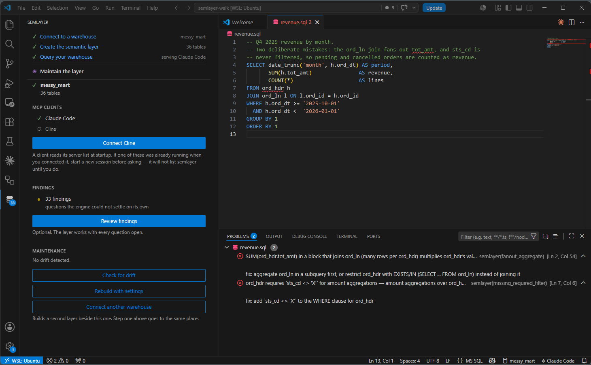
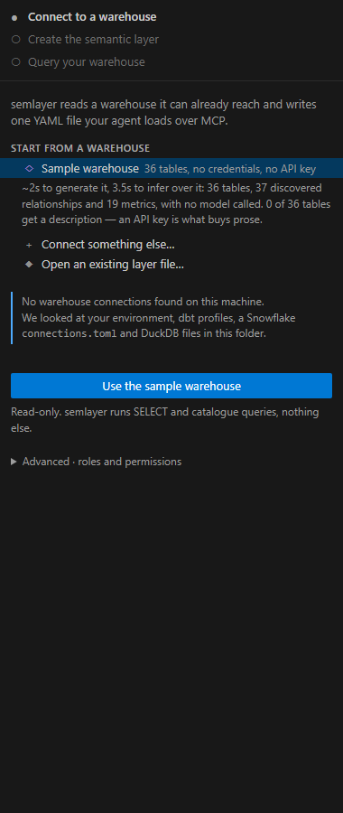
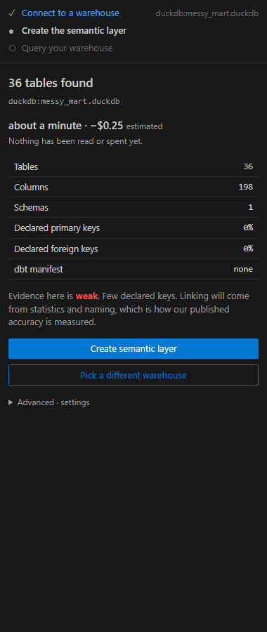
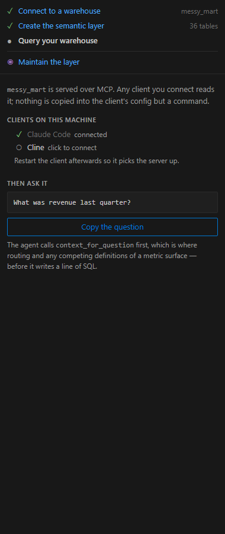

# semlayer for VS Code and Cursor

Infer a semantic layer from your warehouse, then catch wrong SQL before it runs.

A semantic layer tells an agent which table to use, which joins fan out, and
which filters are mandatory. semlayer infers one from a warehouse it can read —
profiling every column, discovering keys and join paths, matching aggregate
tables to their facts — and writes it as one portable YAML file.

<!-- Absolute URLs, not relative: the marketplace serves this README from its
     own domain and relative image paths do not resolve there. They point at
     the public repo, so they go live when the branch does. The generated ones
     come from `npm run gallery`; the window captures are retaken by hand. -->



*A fan-out that doubles a total and a missing mandatory filter — both valid
SQL, both caught before it ran.*

### Three steps

| | | |
|---|---|---|
|  |  |  |
| **Connect** — what this machine can already reach, including a sample warehouse that needs no credentials | **Create** — what the warehouse offers, what it will cost and how long, before anything is spent | **Query** — point an MCP client at the layer and ask it something |

Then day 2: [what drifted](https://raw.githubusercontent.com/semlayer-dev/semlayer/main/extension/media/screenshots/07-drift.png)
in the warehouse, and [the questions](https://raw.githubusercontent.com/semlayer-dev/semlayer/main/extension/media/screenshots/06-review.png)
the engine could not settle on its own — with both consequences shown before
you click either way.

## What this extension does

**Checks your SQL against the layer, as you type.** Not just unknown tables and
columns: the two findings that matter are the ones that *execute cleanly and
return a wrong number*.

```
error  fanout_aggregate         SUM(ord_hdr.tot_amt) in a block that joins ord_ln
                                (many rows per ord_hdr) multiplies ord_hdr's values
       fix: aggregate ord_ln in a subquery first, or restrict ord_hdr with
            EXISTS/IN (SELECT ... FROM ord_ln) instead of joining it

error  missing_required_filter  ord_hdr requires `sts_cd <> 'X'` for amount
                                aggregations
       fix: add `sts_cd <> 'X'` to the WHERE clause for ord_hdr
```

On one real warehouse those two mistakes are the difference between $1,108,382.99
and $4,924,778.63.

**Runs with no warehouse connection.** Linting is the YAML plus a SQL parse, so
it works against any of the 25+ dialects the parser knows, including ones
semlayer has no connector for — Redshift, Databricks, T-SQL, Trino, ClickHouse,
Oracle, MySQL.

**Connects an MCP client in one click.** Claude Code, Cline, Cursor and Claude
Desktop. Writing that JSON by hand is the step that loses people. Start a new
session of the client afterwards — every one of them reads its server list at
startup, so a window that was already open will not see semlayer.

## Requirements

**The `semlayer` CLI.** The extension carries no engine: it runs the same
command you would run in a terminal and reads its `--json` output.

```
pipx install semlayer
```

If it lives somewhere else, set `semlayer.cliPath`.

## Dependencies

- **Runtime npm packages: none.** Only the VS Code API and Node built-ins.
- **MCP: not used by the extension.** MCP is how an *agent* reads the layer.
  This extension talks to the CLI directly, as a subprocess.
- **Network: none.** No telemetry from the extension, no calls home. Inference
  may call an LLM provider, but that is the CLI running under your own key.

## Settings

| Setting | Default | What it does |
|---|---|---|
| `semlayer.cliPath` | `semlayer` | Path to the executable |
| `semlayer.layerPath` | *(empty)* | Layer to lint against; empty means the first one found |
| `semlayer.dialect` | `duckdb` | Dialect to parse with |
| `semlayer.lint.enable` | `true` | Check SQL files at all |
| `semlayer.lint.onType` | `true` | Check while typing, debounced |
| `semlayer.lint.debounceMs` | `500` | Quiet period before checking |

While you type, `parse_error` is held back — half-written SQL does not parse,
and saying so on every keystroke is noise. On open and on save, every rule runs.

## Troubleshooting

**"The semlayer engine was not found on your PATH."**
The extension runs the CLI; it has no engine of its own. `pipx install semlayer`,
or set `semlayer.cliPath` to where yours lives. `semlayer: Show output` prints
what was tried.

**No squiggles in a SQL file.**
In order of likelihood: the file's language is not `sql` (bottom right of the
status bar); there is no layer in the workspace (the status bar names the one
in use, and is hidden when there is none); the SQL references tables the layer
does not have, which is correctly nothing to report rather than an error.

**Squiggles on valid SQL.**
Usually the dialect. `semlayer.dialect` defaults to `duckdb`, and syntax another
engine accepts will not parse as DuckDB. Set it to the warehouse you write for.

**Findings underline the wrong token.**
Expected, within limits. Ranges are reconstructed rather than reported — see
Known gaps below. The message and the fix are always right even when the
underline is a few characters off.

**The client does not list semlayer — `/mcp` shows nothing.**
Start a new session of that client. MCP clients read their server list once,
at startup, so one that was already running when you connected it has never
seen the entry. Nothing is wrong with the config; it is read too early. In
Claude Code the symptom is `/mcp` without semlayer in it, and an agent that
tells you it has no revenue data.

**`semlayer: Get started`** reopens the walkthrough at any time.

## Known gaps

Diagnostic ranges are reconstructed, not reported: a finding carries rule,
severity, message, table, column and fix, but no source offset. The extension
locates the statement and then the identifier inside it, so ranges are close
rather than exact.

There is no `semlayer export` subcommand yet, so exporting to dbt is available
only to an agent over MCP.

## Licence

The engine and this extension are FSL-1.1-ALv2, converting to Apache-2.0 two
years after release. The format specification, its JSON Schemas and the
exporters are Apache-2.0 permanently.
